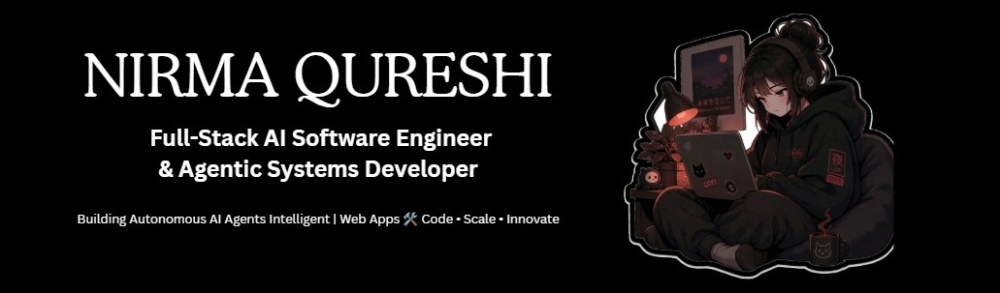

  

  
  
  
  

---

### 👩‍💻 About Me

Hey! I'm Nirma 👋🏻 AI Software Engineer & Full-Stack Agentic Developer. 
Building production-grade multi-agent systems and scalable Web Apps 🛠️ Code • Scale • Innovate for global teams. 

- 🎓 **Current Role:** Faculty & Coordinator at **GIAIC** | Software Engineering Manager at **Technova**.
- 🌍 **Based in:** Karachi, Pakistan 🇵🇰

---
### 🛠️ Weapons (Tech Stack)

- **AI & Workflow Automation:** 
  

- **Frontend Engineering:** 
  

- **Backend & Databases:** 
  

---

### 🌟 Featured Projects

- **Room Matcher AI** — Led development & deployment using Next.js, Docker, and Hugging Face; built an AI-driven platform with 4 agentic models for matching and advisory.
- **AI Energy Data Dashboard** — Built an energy analytics platform using Next.js 16, TypeScript, and Tailwind CSS featuring thermal scans and daily consumption insights.
- **AI Financial & Agricultural App** — Engineered an LLM-powered advisory system and mobile application for expense tracking, predictive market, soil, and weather analysis.
- **Crisis Resource Locator** — Developed an AI agent that locates, verifies, and guides users to the nearest safe location during disaster situations.
- **Full-Stack QuickMart** — Built an advanced e-commerce platform utilizing Next.js, ShadCN UI, Tailwind CSS, Sanity CMS, and Stripe.
- **Full-Stack AI Todo App** — Developed a smart task management and workflow automation application using Next.js, Docker, and agentic AI.

---

  Shipped with ❣️ by Nirma Qureshi

